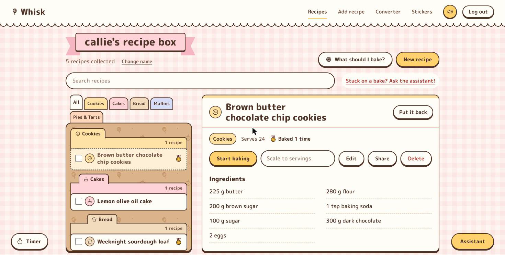

# Whisk

A full-stack baking app styled like a cozy cookbook. Keep recipes as index cards in a recipe box, import them from recipe sites, bake step by step in cooking mode, share them with a link, and ask an AI assistant that knows your saved recipes.

**Live demo:** https://whisk-ten.vercel.app (click **Try the demo** for a sample recipe box, no account needed)



The backend runs on a free tier and sleeps when idle, so the first load can take up to a minute.

## Features

- **Recipe box:** recipes are index cards grouped behind category dividers. Filter by category or search; clicking a card pulls it out beside the box (animated with the View Transitions API), and every open recipe has its own URL.
- **Import from a link:** paste a recipe page's URL and the form fills itself in, from the page's schema.org data or, failing that, Claude.
- **Share links:** a public, read-only link per recipe. Others can save their own copy; the owner can turn it off.
- **Cooking mode:** a prep checklist, one step at a time, servings scaling with friendly fractions, and timers started from times in the steps ("bake for 25 minutes").
- **Baking assistant** powered by Claude, using the user's saved recipes as context, optionally on a background job queue.
- Medals and stickers for bakes, a "What should I bake?" wheel, a shopping list, a unit converter, Undo after deleting, and accounts with JWT auth.
- **Try the demo:** each visitor gets a private, temporary account filled with sample recipes, deleted after a day.

## Tech stack

- **Frontend:** React, React Router, deployed on Vercel
- **Backend:** Flask, SQLAlchemy, Flask-JWT-Extended, Flask-Limiter, gunicorn on Render
- **Database:** PostgreSQL on Neon (SQLite locally)
- **AI:** Anthropic API (Claude Haiku), server-side only, with structured outputs for recipe extraction
- **Background jobs:** my own [task-queue](https://github.com/calliec-1223/task-queue) library (Redis + PostgreSQL)

## Architecture

```
Browser -> React app (Vercel) -> Flask REST API (Render) -> PostgreSQL (Neon)
                                        |
                       CHAT_MODE=sync:  -> Anthropic API
                       CHAT_MODE=queue: -> task-queue (Redis) -> Whisk worker -> Anthropic API
```

In **queue** mode, `POST /chat` queues the question and returns `202 Accepted` with a job ID; a worker (`backend/worker.py`) asks Claude while the browser polls `GET /chat/<id>`. In **sync** mode the request calls Claude directly. Production runs sync because the free tier has no Redis or worker.

### Why a job queue

A Claude answer takes 2-3 seconds, and in sync mode the server process is stuck waiting the whole time. Load test (gunicorn, 2 processes, one user loading recipes 5 times a second while others chat), medians:

| People chatting | Recipe page, sync | Recipe page, queue | Answer, sync | Answer, queue |
|---|---|---|---|---|
| 1 | 7 ms | 6 ms | 2.4 s | 3.1 s |
| 4 | 3,375 ms | 7 ms | 4.9 s | 3.1 s |
| 8 | 9,255 ms | 8 ms | 10.0 s | 5.2 s |

With the queue, pages stay fast however many people chat; a single answer arrives about 0.7 s later because the browser polls once a second. Claude was replaced by a stand-in replaying 20 measured response times, so the test is free and repeatable. Full method: [task-queue README](https://github.com/calliec-1223/task-queue#real-world-use-whisks-ai-baking-assistant).

Measuring real responses also found two bugs: the code crashed on Claude's "thinking" block, and 19 of 20 answers were cut off at the token limit. With low effort and a 1,500-token limit, 0 of 20 were cut off and the median time fell from 3.7 s to 2.4 s.

## Design decisions

- **URL import is guarded against SSRF.** Every request and redirect hop is refused unless the host resolves only to public IPs (blocking `localhost`, private networks and cloud metadata), with size, time and content-type limits. The known DNS-rebinding gap is documented in the code.
- **Structured data before AI.** Most recipe sites embed schema.org `Recipe` JSON-LD, which is exact and free. Only pages without it go to Claude, constrained to a JSON schema, with the page text passed as data, not instructions.
- **Share links use random tokens**, not recipe IDs, so they can't be guessed. Turning a link off deletes it.
- **Demo accounts have no usable password.** The only way in is the token `POST /demo` returns, which expires with the account; expired demos are deleted with everything they made.
- **Undo without a server round trip:** the delete request waits 6 seconds, and leaving the page sends it immediately (`keepalive`).
- **Chat safety and cost:** the API key stays on the server, chat requires login, inputs and outputs are capped and rate limited, and the assistant reads recipes from the database rather than trusting the browser. Queued answers are readable only by whoever asked, and duplicate submissions return the original job.
- **No migrations framework yet:** tables are created at startup, and a startup check adds new columns. It inspects through the same connection as its `ALTER`s, because a second connection deadlocks on Postgres's lock.

## Run locally

```
git clone https://github.com/calliec-1223/whisk.git
cd whisk
python3 -m venv .venv && source .venv/bin/activate
pip install -r backend/requirements.txt
```

Create `backend/.env`:

```
JWT_SECRET_KEY=your-random-secret
ANTHROPIC_API_KEY=your-key
CHAT_MODE=sync
```

Then run `python app.py` in `backend/`, and `npm install && npm start` in `frontend/`. The app runs at http://localhost:3000 and the API at http://127.0.0.1:5000.

To use the job queue instead: start [task-queue](https://github.com/calliec-1223/task-queue)'s Redis and PostgreSQL (`docker compose up -d` there), remove `CHAT_MODE=sync`, add `TQ_POSTGRES_PASSWORD`, and run `python worker.py` in `backend/`. The load test is `python -m bench.load_test` from `backend/`.

## Tests

- **Backend** (177 pytest tests): auth, rate limits, recipe CRUD and validation, per-user access, bakes and stickers, share links, demo accounts and their cleanup, chat, and recipe import (address safety checks and many shapes of recipe data, with DNS and HTTP faked so nothing touches the network). Run `pip install -r backend/requirements-dev.txt`, then `pytest` in `backend/`.
- **Frontend** (15 Jest tests): login and the demo button, recipe box grouping, and servings scaling. Run `CI=true npm test -- --watchAll=false` in `frontend/`.

## Environment variables

| Variable | Purpose |
|---|---|
| `JWT_SECRET_KEY` | Signs login tokens (required) |
| `ANTHROPIC_API_KEY` | The assistant and the AI fallback for recipe import |
| `DATABASE_URL` | Postgres connection string (defaults to local SQLite) |
| `FRONTEND_ORIGIN` | Allowed CORS origin (defaults to http://localhost:3000) |
| `REACT_APP_API_URL` | Backend URL for the frontend, baked in at build time |
| `CHAT_MODE` | `queue` (default) or `sync` |
| `RATELIMIT_STORAGE_URI` | Shared rate-limit store such as Redis (defaults to in-memory) |
| `TQ_REDIS_URL`, `TQ_POSTGRES_*` | Job queue connection (queue mode) |
| `WHISK_FAKE_CLAUDE`, `RATELIMIT_ENABLED` | Load tests only |

## Roadmap

- CI running both test suites on every push
- Database migrations (Flask-Migrate)
- The job queue in production (hosted Redis and a worker)
- Assistant conversation history across pages
