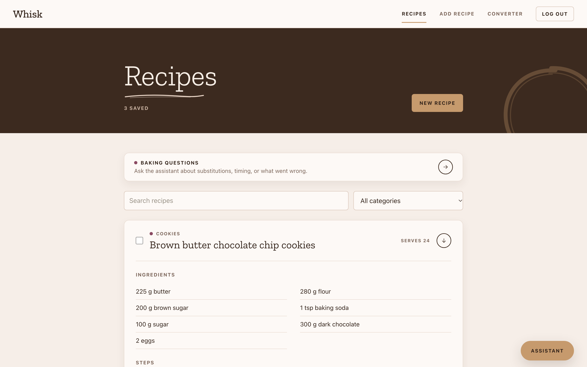

# Whisk

A full-stack baking app. Save and organize recipes, convert baking units, and ask an AI assistant questions that draw on your saved recipes.

**Live demo:** https://whisk-ten.vercel.app


The backend runs on a free tier and sleeps when idle, so the first load after a quiet period can take up to a minute.

## Features

- Account signup and login with JWT authentication and bcrypt password hashing; email is optional; logins last 7 days
- Create, edit, delete, and categorize recipes, stored per user
- Search by title, filter by category, and page through recipes 10 at a time
- Scale a recipe to a different number of servings
- Shopping list built from the recipes you select, with checkboxes
- Ingredient-aware unit converter between grams, cups, and teaspoons
- Baking assistant powered by Claude that answers measurement, substitution, and troubleshooting questions, using the user's saved recipes as context. It can run on a background job queue ([task-queue](https://github.com/calliec-1223/task-queue), which I also built), so slow AI calls never block the web server
- Responsive layout for phones and desktop

## Tech stack

- **Frontend:** React, React Router (Create React App), deployed on Vercel
- **Backend:** Flask, Flask-SQLAlchemy, Flask-JWT-Extended, Flask-Bcrypt, Flask-Limiter, served by gunicorn on Render
- **Database:** PostgreSQL on Neon in production, SQLite locally
- **AI:** Anthropic API (Claude Haiku), called server-side only
- **Background jobs:** my own [task-queue](https://github.com/calliec-1223/task-queue) library (Redis + PostgreSQL), used as a Python package

## Architecture

```
Browser -> React app (Vercel) -> Flask REST API (Render) -> PostgreSQL (Neon)
                                        |
                       CHAT_MODE=sync:  -> Anthropic API
                       CHAT_MODE=queue: -> task-queue (Redis) -> Whisk worker -> Anthropic API
```

The assistant has two modes, set by `CHAT_MODE`:

- **queue** (the default): `POST /chat` adds the question to a job queue and immediately returns `202 Accepted` with a job ID. A separate worker process (`backend/worker.py`) asks Claude. The browser checks `GET /chat/<id>` once a second until the answer is ready.
- **sync**: the web request calls Claude directly and waits for the answer. Production currently runs in this mode, because the free hosting tier has no Redis or background worker.

### Why a job queue

A Claude answer takes 2-3 seconds. In sync mode, the server process handling that request can't serve anyone else in the meantime, so a few people chatting at once slow down every page. I measured this with a load test (Whisk on gunicorn with 2 server processes, while one user loads their recipe list 5 times a second and others chat). Medians:

| People chatting | Recipe page, sync | Recipe page, queue | Answer, sync | Answer, queue |
|---|---|---|---|---|
| 1 | 7 ms | 6 ms | 2.4 s | 3.1 s |
| 4 | 3,375 ms | 7 ms | 4.9 s | 3.1 s |
| 8 | 9,255 ms | 8 ms | 10.0 s | 5.2 s |

With the queue, pages stay fast no matter how many people chat. With one user, an answer arrives about 0.7 s later than in sync mode (the browser checks once a second). Queue mode also runs 4 extra worker processes, so answer times aren't an equal-resources comparison; the page-load difference comes from the web server no longer waiting on Claude. Claude was replaced by a stand-in that replays 20 measured real response times, so the test is free and repeatable. Full method and raw results: [task-queue README](https://github.com/calliec-1223/task-queue#real-world-use-whisks-ai-baking-assistant).

### Bugs found along the way

Measuring real Claude responses turned up two bugs in the original assistant, both fixed:

- **Crash:** the code read the first block of Claude's reply as text, but Claude Haiku 5.5 sends a "thinking" block first. The assistant now joins only the text blocks.
- **Cut-off answers:** thinking counts toward the token limit, so 19 of 20 test answers stopped mid-sentence at 600 tokens. With low effort (recommended for chat), a 1,500-token limit and a request for concise answers, 0 of 20 were cut off, and the median response time dropped from 3.7 s to 2.4 s.

## Design

The interface uses a warm bakery palette (chocolate, blush cream, caramel), Zilla Slab headings, and small uppercase labels. Colors, type sizes, and spacing are defined once as CSS variables in `frontend/src/styles.css`, and text scales with screen width. Form inputs use 16px text so phones don't zoom in on focus.

## Design decisions

- The Anthropic key stays on the server, and the chat endpoint requires login.
- Only the user who asked can read a queued answer; anyone else gets a 404, so job IDs don't even confirm they exist.
- Each chat message carries a unique ID from the browser. If the same request is sent twice (for example, a retry after a dropped connection), the queue returns the original job instead of asking Claude again.
- In queue mode, the Anthropic SDK's own retries are turned off, because the queue already retries failed jobs with backoff. Two retry layers would multiply into up to 9 calls for one question.
- Chat is rate limited per client, input length is capped, and the model's output length is capped, to control cost and abuse.
- The assistant reads the user's recipes from the database instead of trusting data sent by the browser.
- CORS allows only the deployed frontend origin.
- Configuration comes from environment variables, with SQLite as the local default and Postgres in production.
- Recipe input is validated on the server (required fields, lengths that match the database columns, servings from 1 to 1000), so bad input returns a clear 400 instead of a server error. The converter validates its input the same way.
- Normal browsing has a generous rate limit (300 requests per hour per IP); signup, login, and chat have stricter limits.
- The frontend sends every request through two small helpers in `frontend/src/api.js`. The logged-in helper adds the token and returns the user to the login page if it has expired.
- Recipes are fetched individually by ID, so edit pages survive a refresh or a shared link.
- On page load the frontend pings the backend to start waking it from free-tier sleep.

## Run locally

```
git clone https://github.com/calliec-1223/whisk.git
cd whisk
python3 -m venv .venv
source .venv/bin/activate
pip install -r backend/requirements.txt
```

Create `backend/.env`:

```
JWT_SECRET_KEY=your-random-secret
ANTHROPIC_API_KEY=your-key
CHAT_MODE=sync
```

`CHAT_MODE=sync` is the simplest setup: the assistant calls Claude directly. To run it on the job queue instead, see [Run the assistant on the job queue](#run-the-assistant-on-the-job-queue).

Start the backend:

```
cd backend
python app.py
```

In a second terminal, start the frontend:

```
cd frontend
npm install
npm start
```

The app runs at http://localhost:3000 and the API at http://127.0.0.1:5000.

### Run the assistant on the job queue

1. Start [task-queue](https://github.com/calliec-1223/task-queue)'s Redis and PostgreSQL (`docker compose up -d` in that repo).
2. In `backend/.env`, remove `CHAT_MODE=sync` (queue is the default) and add `TQ_POSTGRES_PASSWORD` (the task-queue database password).
3. In a third terminal, start a worker: `cd backend && python worker.py`. Start more to answer more questions at once.

The before/after load test is `python -m bench.load_test` from `backend/` (it uses a Claude stand-in, so it costs nothing).

## Tests

The backend has a pytest suite covering signup, login, rate limits, recipe CRUD, input validation, per-user access, the converter, and the chat endpoints (queued answers, who can read them, duplicate submissions, and sync mode). Tests use an in-memory SQLite database, so they never touch your local data.

```
pip install -r backend/requirements-dev.txt
cd backend
pytest
```

## Environment variables

| Variable | Purpose |
|---|---|
| `JWT_SECRET_KEY` | Signs login tokens (required) |
| `ANTHROPIC_API_KEY` | Enables the baking assistant |
| `DATABASE_URL` | Postgres connection string (defaults to local SQLite) |
| `FRONTEND_ORIGIN` | Allowed CORS origin (defaults to http://localhost:3000) |
| `REACT_APP_API_URL` | Backend URL used by the frontend build (set it before building; Create React App fills it in at build time) |
| `RATELIMIT_STORAGE_URI` | Optional shared store for rate limits, such as a Redis URL (defaults to in-memory) |
| `CHAT_MODE` | `queue` (default) runs the assistant on the job queue; `sync` calls Claude inside the request |
| `TQ_REDIS_URL` | Job queue Redis (defaults to `redis://localhost:6379/0`) |
| `TQ_POSTGRES_PASSWORD` | Job queue history database password (required in queue mode); `TQ_POSTGRES_HOST`, `_PORT`, `_USER`, `_DB` default to the task-queue local setup |
| `WHISK_FAKE_CLAUDE` | `1` replaces Claude with a stand-in that replays measured response times (load tests only) |
| `RATELIMIT_ENABLED` | `0` turns rate limits off (local load tests only) |

## Roadmap

- CI to run the backend tests and frontend build on every push
- Database migrations (Flask-Migrate) instead of `db.create_all()` plus hand-written startup changes
- Run the assistant on the job queue in production (needs a hosted Redis and a background worker service)
- Shared rate limiting across instances
- Keep the assistant's conversation history between questions and across pages